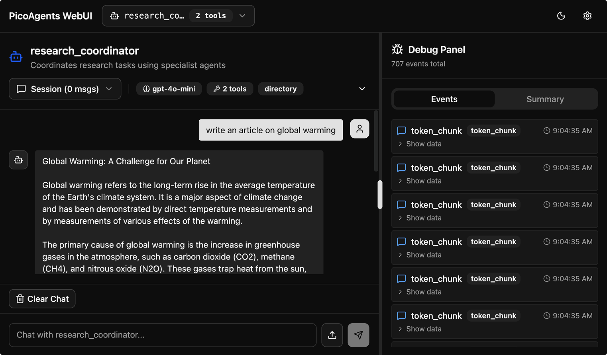

# picoagents-ts

A full TypeScript port of the [PicoAgents](https://github.com/victordibia/designing-multiagent-systems) framework — a lightweight, composable multi-agent system for building AI agents, orchestrators, and workflows.



## Overview

**picoagents-ts** brings the entire PicoAgents ecosystem to TypeScript/Node.js — agents, tools, memory, middleware, workflows, orchestration, and a full-featured web interface — all with first-class TypeScript types and ESM module support.

### What's included

| Module | Description |
|--------|-------------|
| **Agents** | `Agent` with tool calling, structured output, streaming, middleware chains, memory, and compaction |
| **Tools** | `FunctionTool`, `@tool` decorator, `BaseTool` for custom implementations |
| **Memory** | `ListMemory` with pluggable storage backends |
| **Middleware** | Processing pipeline with `BaseMiddleware`, hooks (`StartHook`, `EndHook`), and `TerminationCondition` |
| **Workflows** | DAG-based workflows with `Workflow`, `BaseStep`, `WorkflowRunner`, checkpointing, and conditional edges |
| **LLM Clients** | `OpenAIChatCompletionClient` with streaming, tool support, and structured output |
| **Termination** | `MaxMessage`, `TextMention`, `Timeout`, `TokenUsage`, `Cancellation`, `External`, `FunctionCall`, `Handoff`, `Composite` |
| **Orchestration** | `RoundRobinOrchestrator`, `AIOrchestrator` (LLM-driven selection), `PlanBasedOrchestrator` (multi-step plans) |
| **WebUI** | Hono-based REST API + React frontend for interacting with all entities |

## Quick Start

```bash
# Install dependencies
npm install

# Run the example (no API keys needed — uses mock LLM)
npx tsx examples/round-robin-webui.ts
```

Then open [http://localhost:8080](http://localhost:8080) to see the WebUI.

## Example: Round-Robin Orchestrator

```typescript
import { Agent, MaxMessageTermination, RoundRobinOrchestrator } from "picoagents-ts";
import { serve } from "picoagents-ts/webui";

// Create specialized agents
const researcher = new Agent({
  name: "researcher",
  description: "Gathers information and facts",
  instructions: "You are a thorough researcher...",
  modelClient: myLLMClient,
});

const analyst = new Agent({
  name: "analyst",
  description: "Evaluates findings and synthesizes insights",
  instructions: "You are a skilled analyst...",
  modelClient: myLLMClient,
});

const writer = new Agent({
  name: "writer",
  description: "Crafts polished responses",
  instructions: "You are an expert writer...",
  modelClient: myLLMClient,
});

// Create orchestrator — agents take turns
const orchestrator = new RoundRobinOrchestrator(
  [researcher, analyst, writer],
  new MaxMessageTermination(12)
);

// Launch WebUI
serve({ entities: [researcher, analyst, writer, orchestrator], port: 8080 });
```

## Project Structure

```
src/
├── agents/          # Agent base class and implementation
├── llm/             # LLM client abstraction + OpenAI implementation
├── tools/           # Tool system (FunctionTool, decorator, base)
├── memory/          # Memory system with pluggable storage
├── middleware/       # Middleware chain, hooks, termination
├── workflow/        # DAG workflows, runner, checkpointing
├── termination/     # Orchestration-level termination conditions
├── orchestration/   # Round-robin, AI-driven, plan-based orchestrators
├── webui/           # Hono REST API + React frontend
│   ├── frontend/    # React app (Vite + Tailwind + shadcn/ui)
│   ├── server.ts    # Hono routes + static file serving
│   ├── registry.ts  # Entity registration + introspection
│   ├── sessions.ts  # Session management
│   └── execution.ts # Streaming execution engine
├── messages.ts      # Message types (User, Assistant, Tool, MultiModal)
├── context.ts       # AgentContext with approval workflows
├── types.ts         # Shared types (Usage, AgentResponse, events)
└── index.ts         # Barrel export
```

## Tests

```bash
# Run full test suite
npx vitest run

# Run specific module tests
npx vitest run src/__tests__/test-webui
npx vitest run src/__tests__/test-orchestration
npx vitest run src/__tests__/test-termination
```

On October 18, 2026, a clean install on Node 24.19.0 passed **731 tests across 45 files** and `npm run build`. The current [CI workflow](.github/workflows/ci.yml) reruns the suite and builds the frontend. These checks use test doubles; they do not certify live model-provider or browser integrations.

## Building the Frontend

```bash
cd src/webui/frontend
npm install
npm run build    # Output → src/webui/ui/
```

## Attribution

This project is a TypeScript port of [**PicoAgents**](https://github.com/victordibia/designing-multiagent-systems) by [**Victor Dibia**](https://github.com/victordibia), created as companion code for the book [*Designing Multi-Agent Systems*](https://www.manning.com/books/designing-multi-agent-systems).

The original Python framework, frontend React application, and architectural design are the work of Victor Dibia. This port adapts the codebase to TypeScript with ESM modules, Zod schemas, Hono for the web server, and idiomatic TypeScript patterns throughout.

## License

See [LICENSING.md](LICENSING.md) for the upstream Apache 2.0 terms, attribution, and the unresolved license scope of port-specific modifications.
